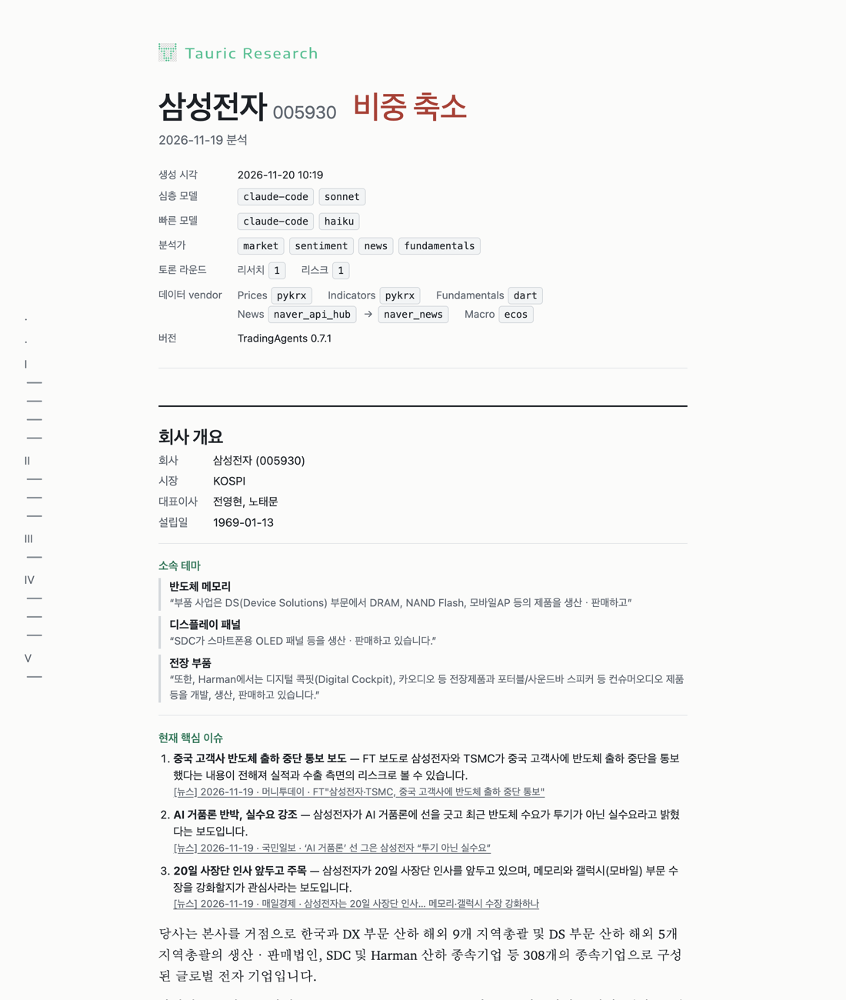
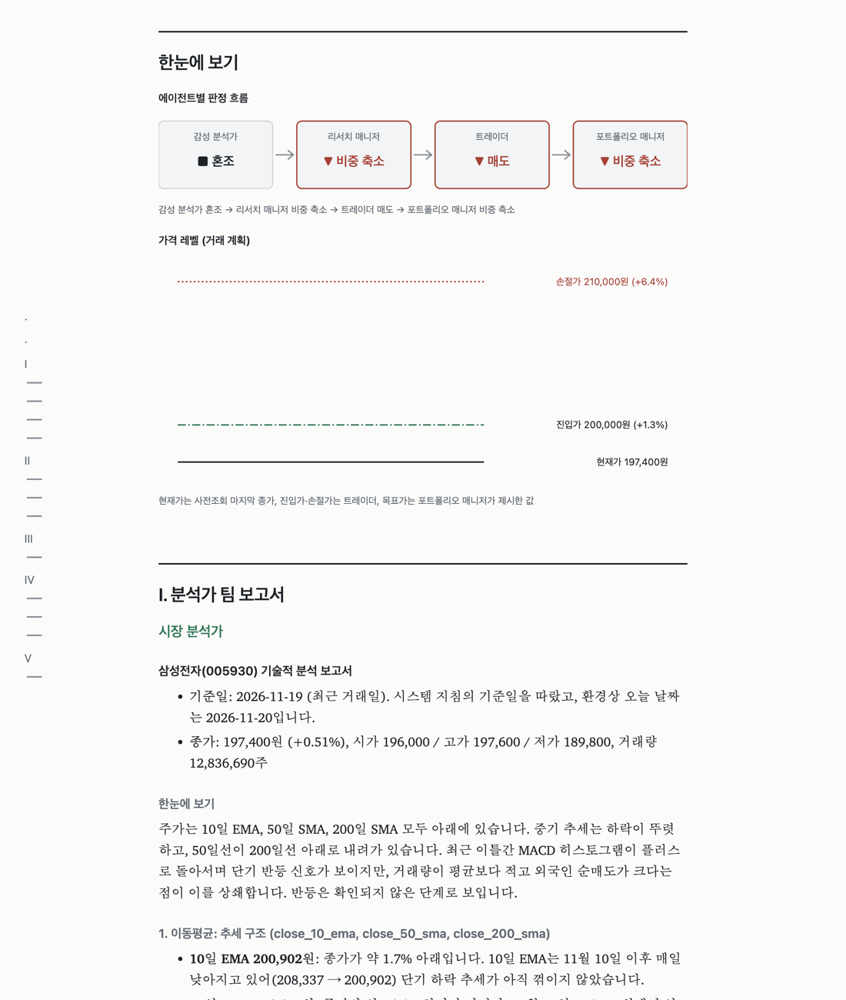

# 샘플 리포트

TradingAgents-KR 가 실제로 만들어 내는 결과물입니다. 합성하거나 편집하지 않은 **실제 실행 결과 1건**을 그대로 담았습니다.

> **⚠ 이 샘플은 투자 자문이 아닙니다.** 기능을 보여주기 위한 예시이며, 매수·매도 추천이나 수익을 보장하지 않습니다. LLM 이 생성한 글에는 오류가 있을 수 있고, 기사 제목 수준의 정보와 공시 목록에 근거합니다. 투자 판단과 그 결과의 책임은 본인에게 있습니다.

## 삼성전자 (005930) — 2026-11-19 기준

결과: **비중 축소** (감성 분석가 혼조 → 리서치 매니저 비중 축소 → 트레이더 매도 → 포트폴리오 매니저 비중 축소)

| 파일 | 설명 |
|---|---|
| [`005930-samsung/report.html`](005930-samsung/report.html) | 차트 포함 전체 리포트 (브라우저로 열기) |
| [`005930-samsung/report.md`](005930-samsung/report.md) | 같은 내용의 마크다운 |
| [`005930-samsung/report-summary.png`](005930-samsung/report-summary.png) | 리포트 상단: 등급, 실행 조건, 회사 개요, 현재 핵심 이슈(뉴스·공시 근거 링크) |
| [`005930-samsung/report-glance.png`](005930-samsung/report-glance.png) | 한눈에 보기: 에이전트별 판정 흐름과 가격 레벨 |

리포트는 분석가 팀(시장·감성·뉴스·재무) → 리서치 팀(강세/약세 토론, 매니저 결정) → 트레이딩 팀 → 리스크 관리 팀(공격/중립/보수) → 포트폴리오 매니저 순서로 쌓입니다.

## 실행 조건

| 항목 | 값 |
|---|---|
| 종목 / 기준일 | 005930 삼성전자 / 2026-11-19 (직전 거래일 종가 기준) |
| 생성 시각 | 2026-11-20 10:19 (KST) |
| 소요 시간 | 6분 24초 |
| 심층 모델 / 간이 모델 | `sonnet` / `haiku` (Claude Code 헤드리스, effort `medium`) |
| 분석가 | market, sentiment, news, fundamentals |
| 토론 라운드 | 리서치 1, 리스크 1 |
| 데이터 vendor | 주가·지표 `pykrx`, 공시 `dart`, 뉴스 `naver_api_hub` → `naver_news`, 거시 `ecos` |
| 버전 | TradingAgents 0.7.1 |

실행은 로컬 웹 UI 가 쓰는 API 로 했고, 같은 조건을 UI 에서 고르면 동일한 흐름이 실행됩니다 (루트 `README.md` 의 "로컬 웹 UI" 참고).

## 읽을 때 알아둘 점

- **기준일을 2026-11-19 로 한 이유**: 네이버 뉴스 조회는 삼성전자처럼 기사가 많은 종목에서 최근 며칠(종목뉴스 약 4일, 주요뉴스 약 1주일)까지만 닿습니다. 오래된 기준일로 실행하면 뉴스 섹션이 "조회 불가"로 채워져 결과물을 보여주기 어렵습니다.
- **LLM 출력은 실행마다 달라집니다.** 같은 조건으로 다시 실행해도 문장과 판단이 조금 다를 수 있습니다.
- **데이터 한계**: 뉴스는 제목·요약 수준이고, 공시는 목록(제목)만 반영되어 매수·매도 방향 같은 세부 내용은 확인하지 못합니다. 리포트 안에 이런 한계가 명시되어 있습니다.
- 리포트 본문에 "환경상 오늘 날짜는 2026-11-20" 같은 LLM 의 부연이 일부 섞여 있습니다. 실제 출력 그대로 두었습니다.
- 리포트 HTML 의 `Tauric Research` 로고와 링크는 이 프로젝트가 기반으로 한 [TauricResearch/TradingAgents](https://github.com/TauricResearch/TradingAgents) 의 출처 표기입니다.
